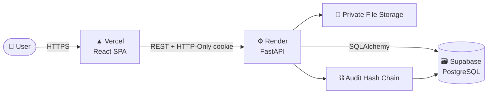
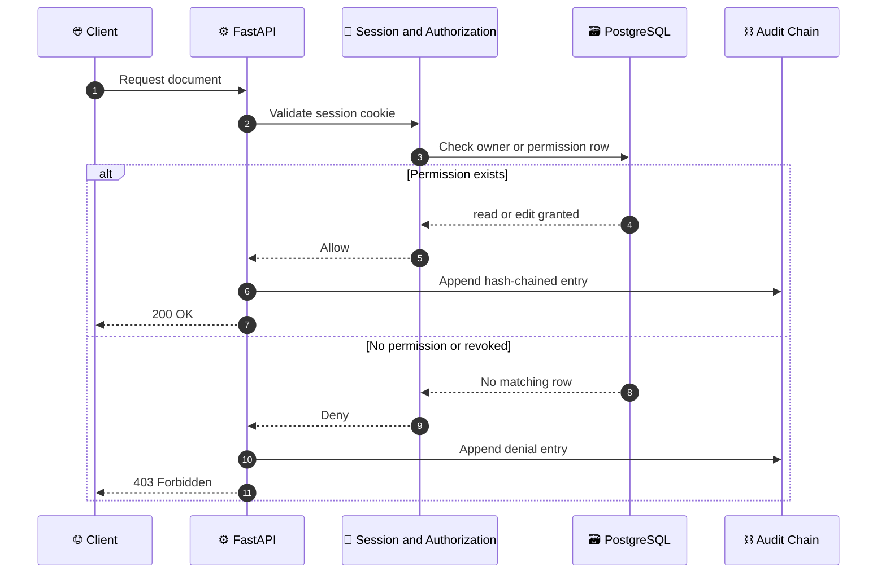
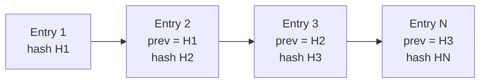

<div align="center">


<a href="https://trust-vault-sandy.vercel.app/login">
  
</a>

<br/>

[](https://trust-vault-sandy.vercel.app/login)
[](https://trustvault-api-zwd5.onrender.com)
[](https://gensmqspmxpsmcijoqfk.supabase.co)


<br/>

### [🚀 Try the Live App](https://trust-vault-sandy.vercel.app/login) &nbsp;·&nbsp; [📘 API Docs](https://trustvault-api-zwd5.onrender.com/api/docs) &nbsp;·&nbsp; [🧪 Run the Tests](#-testing) &nbsp;·&nbsp; [🔒 Security Model](#-security-model)

</div>

---

## 🌐 Live Deployment

TrustVault is deployed and running right now. No setup needed.

| Layer | Platform | Link |
|---|---|---|
| 🖥️ **Frontend** | Vercel | [trust-vault-sandy.vercel.app](https://trust-vault-sandy.vercel.app/login) |
| ⚙️ **Backend API** | Render | [trustvault-api-zwd5.onrender.com](https://trustvault-api-zwd5.onrender.com) |
| 📘 **Swagger Docs** | Render | [/api/docs](https://trustvault-api-zwd5.onrender.com/api/docs) |
| 🗃️ **Database** | Supabase | [gensmqspmxpsmcijoqfk.supabase.co](https://gensmqspmxpsmcijoqfk.supabase.co) |



> 💤 **Heads up:** the API runs on Render, and instances on free plans can sleep when idle. If the first request is slow, give it up to a minute to wake up, then everything runs at normal speed.

---

## ✨ Overview

**TrustVault** is a secure, enterprise-grade document sharing web application built for a seven-day individual hackathon. It is designed around one idea: **access control you can prove, not just promise.**

Most file sharing tools ask you to trust that permissions work. TrustVault makes that trust verifiable:

- 🔐 Authorization is enforced **per document, on every request**
- ⚡ Revocation takes effect on the **very next HTTP call**
- ⛓️ Every action lands in a **tamper-evident audit chain**
- 🧱 Even **administrators cannot read your documents** unless you grant access

---

## 🚀 Key Features

<table>
<tr>
<td width="50%" valign="top">

### 🔑 Robust Authentication and Roles
Argon2id password hashing, server-validated sessions through HTTP-Only cookies, and clean separation between `admin` and `user`.

### 🧱 Administrative Isolation
Admins manage users and review audit trails, but cannot read or download documents unless the owner explicitly grants access.

### 🎯 Granular Permissions
Owners grant `read` or `edit` permission to named, registered users.

### ⚡ Immediate Revocation
Revoking a permission removes database access instantly. The next request is blocked with `403 Forbidden`.

</td>
<td width="50%" valign="top">

### ⛓️ Cryptographic Audit Trail
SHA-256 hash-chained logging with deterministic JSON serialization and a verification endpoint at `/api/audit/integrity`.

### 🗄️ Secure File Storage
Private directory, server-generated UUID filenames, magic byte verification, strict extension whitelisting, and 50MB size validation.

### 🧪 Security and Mutation Tests
18 automated tests covering IDOR, privilege escalation, path traversal, and revocation, plus a mutation test proving the authorization check is necessary.

### 💎 Polished SaaS Interface
React 18, TypeScript, Tailwind CSS, Lucide icons, glassmorphism accents, and a fully responsive layout.

</td>
</tr>
</table>

---

## 🔄 How Every Request Is Protected



---

## 🧰 Tech Stack

| Component | Technology | Version |
|---|---|---|
| **Frontend** | React, TypeScript, Vite, Tailwind CSS, Zustand, React Router | React 18.3, Vite 6.0 |
| **Backend** | Python, FastAPI, SQLAlchemy 2, Alembic, Uvicorn | Python 3.12+, FastAPI 0.115 |
| **Database** | PostgreSQL | PostgreSQL 16 |
| **Authentication** | Argon2id (`argon2-cffi`), Server Session Cookies | argon2-cffi 23.1 |
| **Testing** | Pytest, HTTPX (ASGI) | Pytest 8.3, HTTPX 0.27 |
| **Infrastructure** | Docker Compose, Nginx, Named Persistent Volumes | Docker 24+ |
| **Hosting** | Vercel (frontend), Render (API), Supabase (database) | Live |

---

## 📁 Project Structure

```text
trustvault/
├── backend/
│   ├── alembic/              # Database migration scripts
│   ├── app/
│   │   ├── api/              # REST route endpoints (auth, docs, permissions, audit, admin)
│   │   ├── core/             # Authorization, security (Argon2id), and storage utilities
│   │   ├── models/           # SQLAlchemy 2 models (User, Document, Permission, Audit)
│   │   ├── schemas/          # Pydantic v2 validation models
│   │   └── services/         # Audit hash chain and document business logic
│   ├── tests/                # Automated security, auth, and mutation tests
│   ├── Dockerfile
│   ├── requirements.txt
│   └── seed.py               # Development demo account seed script
├── frontend/
│   ├── src/
│   │   ├── api/              # Axios API client
│   │   ├── components/       # Layout, Navigation, ProtectedRoute guards
│   │   ├── pages/            # Dashboard, Documents, Upload, Detail, Audit, Admin
│   │   └── store/            # Zustand auth state
│   ├── Dockerfile
│   ├── nginx.conf
│   └── package.json
├── docs/
│   ├── API.md                # REST API documentation
│   ├── DEPLOYMENT.md         # Production setup and ops guide
│   ├── DEMO_SCRIPT.md        # 5-minute hackathon demo script
│   ├── PERMISSIONS.md        # Authorization matrix and revocation semantics
│   └── TESTING.md            # Automated testing and mutation test details
├── docker-compose.yml        # Multi-container orchestration
├── THREATS.md                # Threat model and risk assessment
├── PROMPTS.md                # AI usage log and engineering evidence
└── README.md
```

---

## ⚡ Quickstart

Pick the path that suits you.

<details open>
<summary><b>🟢 Option A: Use the live app (zero setup)</b></summary>

<br/>

1. Open **[trust-vault-sandy.vercel.app](https://trust-vault-sandy.vercel.app/login)**
2. Register a new account, or sign in with a demo account below
3. Upload a document, share it, revoke it, and check the audit trail

</details>

<details>
<summary><b>🐳 Option B: Run locally with Docker Compose</b></summary>

<br/>

**1. Clone and configure**

```bash
git clone https://github.com/mdadilshariff/trustvault.git
cd trustvault
cp .env.example .env
```

**2. Launch services**

```bash
docker compose up -d --build
```

| Service | Address |
|---|---|
| 🗃️ Database (PostgreSQL) | `localhost:5432` |
| ⚙️ Backend (FastAPI) | http://localhost:8000 |
| 🖥️ Frontend (Nginx) | http://localhost:5173 |

**3. Seed demo accounts**

```bash
docker compose exec backend python seed.py
```

**4. Open the app**

- 🌐 Web App: http://localhost:5173
- 📘 Swagger Docs: http://localhost:8000/api/docs

</details>

<details>
<summary><b>🏗️ Build the frontend bundle</b></summary>

<br/>

```bash
cd frontend
npm install
npm run build
```

The production build produces an optimized static bundle in `frontend/dist/`.

</details>

---

## 👥 Demo Accounts

| Role | Email | Username | Password |
|---|---|---|---|
| 🛠️ Administrator | `admin@trustvault.dev` | `admin` | `Admin1234!` |
| 📄 Document Owner | `alice@trustvault.dev` | `alice` | `Alice1234!` |
| 🤝 Collaborator | `bob@trustvault.dev` | `bob` | `Bob12345!` |

> ⚠️ Created by `seed.py` for development and demo use. Change or remove them for any real deployment.

### 🎬 60-Second Walkthrough

1. **Sign in as alice** and upload a document
2. **Grant bob read access**, then sign in as bob and open it
3. **Revoke bob's access**, and his very next request returns `403 Forbidden`
4. **Sign in as admin** and confirm the document is still unreadable, while the audit trail records every step
5. **Verify the chain** by calling `/api/audit/integrity`

The full 5-minute script lives in [`docs/DEMO_SCRIPT.md`](docs/DEMO_SCRIPT.md).

---

## 🧪 Testing

```bash
pytest backend -v
```

<details>
<summary><b>📋 Expected output (click to expand)</b></summary>

```text
backend/tests/test_auth.py::test_register_and_login PASSED
backend/tests/test_auth.py::test_login_wrong_password PASSED
backend/tests/test_auth.py::test_me_unauthenticated PASSED
backend/tests/test_auth.py::test_me_authenticated PASSED
backend/tests/test_auth.py::test_duplicate_register PASSED
backend/tests/test_auth.py::test_logout PASSED
backend/tests/test_security.py::test_bob_cannot_read_alices_document PASSED
backend/tests/test_security.py::test_bob_cannot_download_alices_document PASSED
backend/tests/test_security.py::test_bob_cannot_edit_alices_document PASSED
backend/tests/test_security.py::test_bob_cannot_delete_alices_document PASSED
backend/tests/test_security.py::test_read_only_cannot_edit PASSED
backend/tests/test_security.py::test_revoked_access_blocks_immediately PASSED
backend/tests/test_security.py::test_bob_cannot_manage_permissions PASSED
backend/tests/test_security.py::test_unauthenticated_cannot_list_documents PASSED
backend/tests/test_security.py::test_unauthenticated_cannot_upload PASSED
backend/tests/test_security.py::test_path_traversal_in_upload PASSED
backend/tests/test_security.py::test_admin_not_auto_doc_access PASSED
backend/tests/test_security.py::test_mutation_authorization_check_is_necessary PASSED

======================= 18 passed, 28 warnings in 0.97s =======================
```

</details>

| Category | What is proven |
|---|---|
| 🔑 **Authentication** | Register, login, wrong password, session checks, duplicate accounts, logout |
| 🚫 **IDOR** | A non-owner cannot read, download, edit, or delete another user's document |
| 📈 **Privilege escalation** | Read-only users cannot edit, collaborators cannot manage permissions, admins get no automatic access |
| ⚡ **Revocation** | Access is blocked on the very next request after removal |
| 🔒 **Unauthenticated access** | Listing and uploading are rejected without a session |
| 📂 **Path traversal** | Malicious filenames cannot escape private storage |
| 🧬 **Mutation test** | Disabling the authorization check shows the protection genuinely depends on it |

Details: [`docs/TESTING.md`](docs/TESTING.md)

---

## 🔒 Security Model

TrustVault follows a **deny by default** philosophy. Every document operation passes through a central authorization layer before any data is touched.

| Layer | Protection |
|---|---|
| 🔐 **Passwords** | Argon2id hashing via `argon2-cffi` |
| 🍪 **Sessions** | Server-validated, delivered through HTTP-Only cookies |
| 🎯 **Authorization** | Document-level checks on every request, no cached grants |
| ⚡ **Revocation** | Database row removal, effective on the next HTTP request |
| 🧱 **Admin boundary** | Administrative role does not imply document access |
| 🗄️ **Uploads** | Magic bytes, extension whitelist, 50MB limit, UUID filenames, private directory |
| ⛓️ **Audit** | SHA-256 hash chain, deterministic JSON, verification endpoint |

### ⛓️ How the audit chain works



Each entry stores the hash of the previous one and is serialized deterministically before hashing. Changing any single row breaks every hash after it, and `/api/audit/integrity` detects it automatically.

Full risk analysis: [`THREATS.md`](THREATS.md)

---

## 🔗 API at a Glance

| Resource | Where |
|---|---|
| Live API base | `https://trustvault-api-zwd5.onrender.com` |
| Interactive Swagger UI | [`/api/docs`](https://trustvault-api-zwd5.onrender.com/api/docs) |
| Audit integrity check | `GET /api/audit/integrity` |
| Full reference | [`docs/API.md`](docs/API.md) |

---

## 📚 Documentation

| Document | Purpose |
|---|---|
| [`docs/API.md`](docs/API.md) | REST API reference |
| [`docs/PERMISSIONS.md`](docs/PERMISSIONS.md) | Authorization matrix and revocation semantics |
| [`docs/TESTING.md`](docs/TESTING.md) | Automated testing and mutation test details |
| [`docs/DEPLOYMENT.md`](docs/DEPLOYMENT.md) | Production setup and operations guide |
| [`docs/DEMO_SCRIPT.md`](docs/DEMO_SCRIPT.md) | 5-minute hackathon demo script |
| [`THREATS.md`](THREATS.md) | Threat model and risk assessment |
| [`PROMPTS.md`](PROMPTS.md) | AI usage log and engineering evidence |

---

## 🚧 Known Boundaries and Limitations

Honest security means stating what the system cannot do.

- **Local download retention.** Revocation immediately terminates access to cloud operations, metadata updates, and future downloads. It cannot remotely erase files a user previously downloaded to their personal device.
- **Database superuser chain rewrite.** The SHA-256 hash chain prevents single-row tampering and concurrent insertion races. However, an attacker with full database superuser access could theoretically recompute the entire table. External write-once logging (WORM) is recommended for high-compliance deployments.

---

## 👤 Author

<div align="center">

Built solo by **Dil** for a seven-day individual hackathon.

[](https://github.com/mdadilshariff)

<br/>

**If TrustVault impressed you, drop a ⭐ on the repo.**

*Trust, but verify. Then verify the verifier.*


</div>
