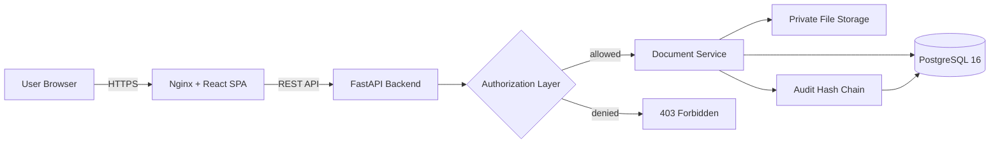
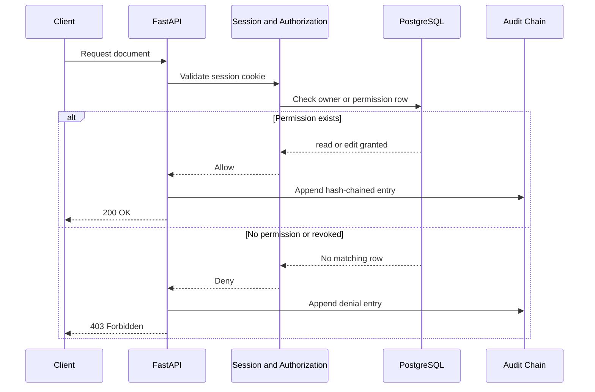
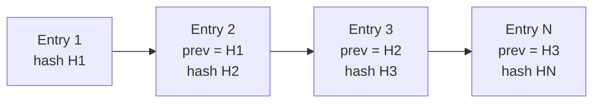

<div align="center">

# 🛡️ TrustVault

### Secure, enterprise-grade document sharing with provable access control

**Fine-grained permissions · Instant revocation · Tamper-evident audit trail · Private file storage**

<br/>


<br/>


<br/>


<br/>

[Features](#-key-features) · [Architecture](#-architecture) · [Quickstart](#-quickstart) · [Demo Accounts](#-demo-accounts) · [Testing](#-testing) · [Security Model](#-security-model) · [Docs](#-documentation) · [Limitations](#-known-boundaries--limitations)

</div>

---

## ✨ Overview

**TrustVault** is a secure document sharing web application built for a seven-day individual hackathon. It is designed around one idea: **access control you can prove, not just promise.**

Most file sharing tools make you trust that permissions work. TrustVault makes that trust verifiable with document-level authorization enforced on every request, revocation that takes effect on the very next HTTP call, and a cryptographic audit log that exposes any tampering.

> 🔐 **Even administrators cannot read your documents.** Admins manage users and review audit trails, but document access is granted only by the document owner.

---

## 🚀 Key Features

| | Feature | What it means |
|---|---|---|
| 🔑 | **Robust Authentication & Roles** | Argon2id password hashing, server-validated sessions via HTTP-Only cookies, and clean separation between `admin` and `user` roles. |
| 🧱 | **Administrative Isolation** | Admins manage users and review audit trails, but cannot read or download documents unless the owner explicitly grants access. |
| 🎯 | **Granular Document Permissions** | Owners grant `read` or `edit` permission to named, registered users. |
| ⚡ | **Immediate Revocation** | Revoking a permission removes database access instantly. The very next request is blocked with `403 Forbidden`. |
| ⛓️ | **Cryptographic Audit Trail** | SHA-256 hash-chained logging with deterministic JSON serialization, plus an automated verification endpoint at `/api/audit/integrity`. |
| 🗄️ | **Secure File Storage** | Private directory, server-generated UUID filenames, magic byte verification, strict extension whitelisting, and 50MB size validation. |
| 🧪 | **Security and Mutation Tests** | 18 automated tests covering IDOR, privilege escalation, path traversal, and revocation, plus an isolated mutation test proving the authorization check is necessary. |
| 💎 | **Polished SaaS Interface** | React 18, TypeScript, Tailwind CSS, Lucide icons, glassmorphism accents, and a fully responsive layout. |

---

## 🏗️ Architecture



### How every request is protected



---

## 🧰 Tech Stack

| Component | Technology | Version |
|---|---|---|
| **Frontend** | React, TypeScript, Vite, Tailwind CSS, Zustand, React Router | React 18.3, Vite 6.0 |
| **Backend** | Python, FastAPI, SQLAlchemy 2, Alembic, Uvicorn | Python 3.12+, FastAPI 0.115 |
| **Database** | PostgreSQL | PostgreSQL 16 Alpine |
| **Authentication** | Argon2id (`argon2-cffi`), Server Session Cookies | argon2-cffi 23.1 |
| **Testing** | Pytest, HTTPX (ASGI) | Pytest 8.3, HTTPX 0.27 |
| **Infrastructure** | Docker Compose, Nginx, Named Persistent Volumes | Docker 24+ |

---

## 📁 Project Structure

```text
trustvault/
├── backend/
│   ├── alembic/              # Database migration scripts
│   ├── app/
│   │   ├── api/              # REST route endpoints (auth, docs, permissions, audit, admin)
│   │   ├── core/             # Authorization, security (Argon2id), and storage utilities
│   │   ├── models/           # SQLAlchemy 2 models (User, Document, Permission, Audit)
│   │   ├── schemas/          # Pydantic v2 validation models
│   │   └── services/         # Audit hash chain and document business logic
│   ├── tests/                # Automated security, auth, and mutation tests
│   ├── Dockerfile
│   ├── requirements.txt
│   └── seed.py               # Development demo account seed script
├── frontend/
│   ├── src/
│   │   ├── api/              # Axios API client
│   │   ├── components/       # Layout, Navigation, ProtectedRoute guards
│   │   ├── pages/            # Dashboard, Documents, Upload, Detail, Audit, Admin
│   │   └── store/            # Zustand auth state
│   ├── Dockerfile
│   ├── nginx.conf
│   └── package.json
├── docs/
│   ├── API.md                # REST API documentation
│   ├── DEPLOYMENT.md         # Production setup and ops guide
│   ├── DEMO_SCRIPT.md        # 5-minute hackathon demo script
│   ├── PERMISSIONS.md        # Authorization matrix and revocation semantics
│   └── TESTING.md            # Automated testing and mutation test details
├── docker-compose.yml        # Multi-container orchestration
├── THREATS.md                # Threat model and risk assessment
├── PROMPTS.md                # AI usage log and engineering evidence
└── README.md
```

---

## ⚡ Quickstart

Local development with Docker Compose. You only need **Docker 24+**.

### 1. Clone and configure

```bash
git clone https://github.com/mdadilshariff/trustvault.git
cd trustvault
cp .env.example .env
```

### 2. Launch services

```bash
docker compose up -d --build
```

This boots three containers:

| Service | Address |
|---|---|
| 🗃️ **Database** (PostgreSQL) | `localhost:5432` |
| ⚙️ **Backend** (FastAPI) | http://localhost:8000 |
| 🖥️ **Frontend** (Nginx) | http://localhost:5173 |

### 3. Seed demo accounts

```bash
docker compose exec backend python seed.py
```

### 4. Open the app

- 🌐 **Web App:** http://localhost:5173
- 📘 **Swagger Docs:** http://localhost:8000/api/docs

---

## 👥 Demo Accounts

| Role | Email | Username | Password |
|---|---|---|---|
| 🛠️ Administrator | `admin@trustvault.dev` | `admin` | `Admin1234!` |
| 📄 Document Owner | `alice@trustvault.dev` | `alice` | `Alice1234!` |
| 🤝 Collaborator | `bob@trustvault.dev` | `bob` | `Bob12345!` |

> ⚠️ These credentials are for local development only. Never seed them in a production deployment.

### 🎬 Suggested walkthrough

1. Sign in as **alice** and upload a document.
2. Grant **bob** read access and confirm he can open it.
3. Revoke bob's access and watch his next request return `403 Forbidden`.
4. Sign in as **admin** and confirm the document is still unreadable, while the audit trail shows every step.
5. Call `/api/audit/integrity` to verify the hash chain end to end.

See [`docs/DEMO_SCRIPT.md`](docs/DEMO_SCRIPT.md) for the full 5-minute script.

---

## 🧪 Testing

Run all 18 automated tests:

```bash
pytest backend -v
```

<details>
<summary><b>📋 Expected output (click to expand)</b></summary>

```text
backend/tests/test_auth.py::test_register_and_login PASSED
backend/tests/test_auth.py::test_login_wrong_password PASSED
backend/tests/test_auth.py::test_me_unauthenticated PASSED
backend/tests/test_auth.py::test_me_authenticated PASSED
backend/tests/test_auth.py::test_duplicate_register PASSED
backend/tests/test_auth.py::test_logout PASSED
backend/tests/test_security.py::test_bob_cannot_read_alices_document PASSED
backend/tests/test_security.py::test_bob_cannot_download_alices_document PASSED
backend/tests/test_security.py::test_bob_cannot_edit_alices_document PASSED
backend/tests/test_security.py::test_bob_cannot_delete_alices_document PASSED
backend/tests/test_security.py::test_read_only_cannot_edit PASSED
backend/tests/test_security.py::test_revoked_access_blocks_immediately PASSED
backend/tests/test_security.py::test_bob_cannot_manage_permissions PASSED
backend/tests/test_security.py::test_unauthenticated_cannot_list_documents PASSED
backend/tests/test_security.py::test_unauthenticated_cannot_upload PASSED
backend/tests/test_security.py::test_path_traversal_in_upload PASSED
backend/tests/test_security.py::test_admin_not_auto_doc_access PASSED
backend/tests/test_security.py::test_mutation_authorization_check_is_necessary PASSED

======================= 18 passed, 28 warnings in 0.97s =======================
```

</details>

### What the suite proves

| Category | Coverage |
|---|---|
| **Authentication** | Register, login, wrong password, session checks, duplicate accounts, logout |
| **IDOR** | A non-owner cannot read, download, edit, or delete another user's document |
| **Privilege escalation** | Read-only users cannot edit, collaborators cannot manage permissions, admins get no automatic document access |
| **Revocation** | Access is blocked on the very next request after permission removal |
| **Unauthenticated access** | Listing and uploading are rejected without a session |
| **Path traversal** | Malicious upload filenames cannot escape private storage |
| **Mutation test** | An isolated test disables the authorization check to show that the protection genuinely depends on it |

Details live in [`docs/TESTING.md`](docs/TESTING.md).

---

## 🏗️ Building the Frontend

```bash
cd frontend
npm install
npm run build
```

The production build produces an optimized static bundle in `frontend/dist/`.

---

## 🔒 Security Model

TrustVault follows a **deny by default** philosophy. Every document operation passes through a central authorization layer before any data is touched.

| Layer | Protection |
|---|---|
| **Passwords** | Argon2id hashing via `argon2-cffi` |
| **Sessions** | Server-validated, delivered through HTTP-Only cookies |
| **Authorization** | Document-level checks on every request, no cached grants |
| **Revocation** | Database row removal, effective on the next HTTP request |
| **Admin boundary** | Administrative role does not imply document access |
| **Uploads** | Magic byte verification, extension whitelist, 50MB limit, UUID filenames, private directory |
| **Audit** | SHA-256 hash chain with deterministic JSON serialization and verification endpoint |

### ⛓️ How the audit chain works



Each entry stores the hash of the previous entry and is serialized deterministically before hashing. Changing any single row breaks every hash after it, and `/api/audit/integrity` detects it automatically.

For the full risk analysis see [`THREATS.md`](THREATS.md).

---

## 📚 Documentation

| Document | Purpose |
|---|---|
| [`docs/API.md`](docs/API.md) | REST API reference |
| [`docs/PERMISSIONS.md`](docs/PERMISSIONS.md) | Authorization matrix and revocation semantics |
| [`docs/TESTING.md`](docs/TESTING.md) | Automated testing and mutation test details |
| [`docs/DEPLOYMENT.md`](docs/DEPLOYMENT.md) | Production setup and operations guide |
| [`docs/DEMO_SCRIPT.md`](docs/DEMO_SCRIPT.md) | 5-minute hackathon demo script |
| [`THREATS.md`](THREATS.md) | Threat model and risk assessment |
| [`PROMPTS.md`](PROMPTS.md) | AI usage log and engineering evidence |

---

## 🚧 Known Boundaries & Limitations

Honest security means stating what the system cannot do.

- **Local download retention.** Revocation immediately terminates access to cloud operations, metadata updates, and future downloads. It cannot remotely erase files a user previously downloaded to their personal device.
- **Database superuser chain rewrite.** The SHA-256 hash chain prevents single-row tampering and concurrent insertion races. However, an attacker with full database superuser access could theoretically recompute the entire table. External write-once logging (WORM) is recommended for high-compliance deployments.

---

## 👤 Author

Built by **Dil** ([@mdadilshariff](https://github.com/mdadilshariff)) as a solo entry for a seven-day individual hackathon.

<div align="center">

<br/>

**If TrustVault helped or inspired you, consider leaving a ⭐ on the repository.**

*Trust, but verify. Then verify the verifier.*

</div>
